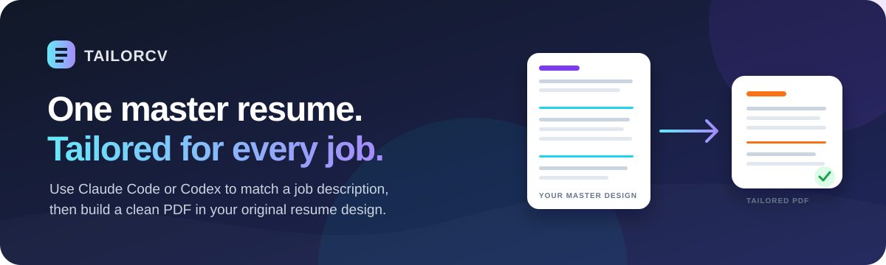
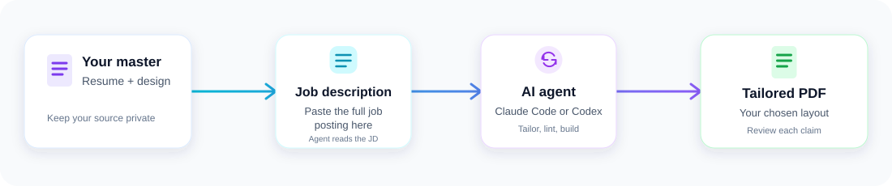

# TailorCV

<p align="center">
  
</p>

<p align="center">
  <a href="https://tailorcv.niteshjainy.online/"><strong>📘 Beginner setup guide</strong></a>
  &nbsp;·&nbsp; <a href="docs/04-USAGE.md">How it works</a>
  &nbsp;·&nbsp; <a href="https://github.com/niteshjainy/tailorcv">GitHub repository</a>
</p>

<p align="center">
  
  
  
</p>

Tailor your resume to each job description with Claude Code or Codex. The visual guide covers setup, adding your master resume, and tailoring from a full job posting; its source is [`docs/index.html`](docs/index.html).

Reference-design extraction: [master PDF/DOCX workflow](docs/06-REFERENCE-DESIGN.md). Requires Node.js 22.13+. `npm run design` reads the actual reference. `maxPages: "auto"` follows the master and asks before expanding a one-page resume. Missing fonts are downloaded when permitted, or replaced with a disclosed default. Run `npm run test:design` and `npm run test:policy` to verify the pipeline.

Formatting safeguards preserve section separators, render one summary in the master's position, choose compatible font families, and calibrate fixed paragraph gaps against LibreOffice output. `npm run test:formatting` verifies these regressions and checks that missing separators block the final save. The 98% threshold measures the explicitly listed style checks, not overall/pixel accuracy; see the workflow guide for scope and tolerances.

Tailor your resume to any job description with an AI coding agent, and get a clean, ATS-safe PDF in seconds.

You keep **one** resume in the repo (`resume/base_resume.json`). For every job, you paste the job description (JD) to the agent. The agent rewrites the summary, skills and recent-job bullets to match the JD, checks its own work with a linter, and builds a 2-page PDF with a fixed, professional layout.

```
Master resume + full job description  →  AI agent  →  tailored PDF
```

<p align="center">
  
</p>

Why a Word file in the middle? PDFs drawn directly by code often have broken text (ligatures become unreadable characters), overlapping lines and wrong fonts, which ATS software cannot parse. Converting a real Word file with LibreOffice gives real text, embedded Calibri-compatible fonts and correct bullet wrapping. See `samples/sample_resume.pdf` for the result.

> **You are responsible for what your resume says.** The agent is told to mirror each JD (add the JD's skills and keywords and write achievements in the JD's language). Review every resume before you send it and delete anything you could not explain in an interview. Estimated numbers are always flagged in the agent's reply; replace them with your real figures.

## Quick start

**New here? Follow the [visual setup guide](https://tailorcv.niteshjainy.online/).** For the short version:

1. Install **Node.js 22.13+** (https://nodejs.org) and get this project (`git clone` or download the ZIP).
2. In the project folder run: `npm run setup` (installs the Node packages and offers to install LibreOffice).
3. Connect an AI agent, for example Claude Code: see [docs/03-CONNECT-AN-LLM.md](docs/03-CONNECT-AN-LLM.md).
4. Put your resume into `resume/base_resume.json`: either paste it to the agent ("onboarding") or edit the JSON: see [docs/02-CONFIGURE-YOUR-RESUME.md](docs/02-CONFIGURE-YOUR-RESUME.md).
5. Start the agent in this folder and send:

   ```
   Company: Acme
   JD:
   <paste the job description>
   ```
<br>

**Output:** Your PDF appears in `output/Acme/<first>_<last>_resume.pdf`.

Try it first with the sample resume: `npm run example` creates `output/Example/alex_morgan_resume.pdf`.

## Documentation

| Guide | What it covers |
|---|---|
| [docs/index.html](docs/index.html) | Visual guide with copy-paste command cards, diagrams and a resume preview (also works as a GitHub Pages site) |
| [docs/01-INSTALL.md](docs/01-INSTALL.md) | Install Node, LibreOffice and the project on Windows, Mac, Linux (with auto-install) |
| [docs/02-CONFIGURE-YOUR-RESUME.md](docs/02-CONFIGURE-YOUR-RESUME.md) | Your base resume, every field, `config.json` options |
| [docs/03-CONNECT-AN-LLM.md](docs/03-CONNECT-AN-LLM.md) | Connect Claude Code (or another agent), API key, no-agent mode |
| [docs/04-USAGE.md](docs/04-USAGE.md) | Daily workflow, prompts, cover letters, commands |
| [docs/05-TROUBLESHOOTING-AND-CUSTOMIZING.md](docs/05-TROUBLESHOOTING-AND-CUSTOMIZING.md) | Fix common errors, change rules, A4 paper, strict mode |
| [kit/FORMAT_SPEC.md](kit/FORMAT_SPEC.md) | The exact layout numbers and lint rules |

## What is in the repo

```
CLAUDE.md / AGENTS.md     instructions the agent reads automatically (same content)
LESSONS.md                mistakes and rules the agent learns from (it adds to this file)
config.json               output folder, file names, page limit, lint thresholds
resume/base_resume.json   YOUR resume (the sample until you replace it)
resume/source/            drop your old resume PDF here (git-ignored)
kit/                      builder, linter, runners, format spec
scripts/setup.js          environment check and installer ("npm run setup", "npm run doctor")
samples/                  sample PDF
work/                     per-job working files (git-ignored)
output/                   finished PDFs (git-ignored)
```

## Commands

| Command | What it does |
|---|---|
| `npm run setup` | Check everything, install missing pieces (asks first) |
| `npm run doctor` | Check only |
| `npm run lint -- work/acme.json` | Check a tailored resume against your base resume and the rules |
| `npm run resume -- work/acme.json "Acme" --jd work/acme_jd.txt` | Lint, build and save the PDF |
| `npm run cover -- work/acme_cover.json "Acme"` | Build a cover letter PDF |
| `npm run example` | Build the sample resume |

## Privacy

Your resume text is sent to the AI provider you connect. Your real `resume/base_resume.json`, source uploads, extracted personal design/report, generated PDFs, font cache and working files are git-ignored by default. Only the fictional `resume/base_resume.example.json` is published. `npm run setup` copies it to your private base file on a fresh checkout. Without an extracted design, the builders use `kit/design_defaults.json`.

Before committing, run `npm run check:public` to check tracked/unignored files for private paths, personal contact details and potential access keys. Avoid force-adding ignored files. The project is free to use; the AI provider you choose may require its own account or subscription.

Developer tests use generated/fictional fixtures and do not require a real user's private resume or PDFs. `RESUME_BASE` can select a separate content fixture; `RESUME_DESIGN` selects a separate design, and `RESUME_ROOT` selects output storage.

## License

MIT, see [LICENSE](LICENSE).
